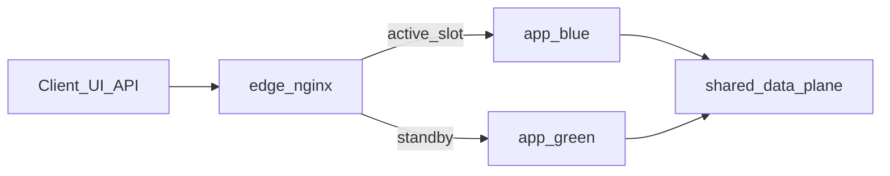

# Build & Deployment — Blue-green (local) + Terraform (AWS design)

## Strategy

NebulaStack demonstrates **progressive deployment** with a **blue-green** cutover:

| Plane | Local (classroom, $0) | AWS (IaC design) |
|-------|----------------------|------------------|
| Edge / traffic | nginx (`:3000` UI, `:8080` API) | ALB listener rules / target groups |
| App fleets | Compose projects `nebulastack-blue` / `nebulastack-green` | Two ECS services (or task sets) + Lambda aliases |
| Data | Shared Postgres, Redis, RabbitMQ, Mongo, mocks | Shared RDS / ElastiCache / SQS / DocumentDB |
| Immutable tag | `IMAGE_TAG=$(git rev-parse --short HEAD)` | Same SHA on ECR + ECS/Lambda |

Single-stack Compose (`deploy/compose/docker-compose.yml`) remains the **dev / E2E** path. Blue-green is the **Unit 6 deployment demo**.



## Local commands (PowerShell)

From repo root. Stop the single-stack first if ports 3000/8080 are taken:

```powershell
cd deploy\compose
docker compose down
cd ..\..
.\deploy\scripts\bg-up.ps1
.\deploy\scripts\bg-status.ps1
# After code change:
.\deploy\scripts\bg-deploy.ps1
# Rollback:
.\deploy\scripts\bg-switch.ps1 -Color blue   # or green
```

Bash equivalents: `bg-up.sh`, `bg-deploy.sh`, `bg-switch.sh`, `bg-status.sh`.

### What each script does

| Script | Behavior |
|--------|----------|
| `bg-up` | Create `nebulastack-net`, start data plane, build/start **blue**, edge → blue |
| `bg-deploy` | Detect standby color, `build` with git SHA, `up` standby, wait `/healthz`, switch edge |
| `bg-switch` | Rewrite `edge/nginx.conf` from template + `nginx -s reload` |
| `bg-status` | Active color, container health, image tags, public `/healthz` |

Optional: `.\deploy\scripts\bg-deploy.ps1 -StopPrevious` stops the old color after cutover.

## Compose files

| File | Role |
|------|------|
| `docker-compose.yml` | Dev single-stack (E2E) |
| `docker-compose.data.yml` | Shared data + `external-mocks` |
| `docker-compose.app.yml` | One app color (`DEPLOY_COLOR`, no host 3000/8080) |
| `docker-compose.edge.yml` | Public nginx edge |
| `edge/nginx.conf.template` | Upstream placeholder `ACTIVE_COLOR-*` |
| `edge/active-color` | `blue` or `green` |

## Rollback

Edge switch is instant relative to rebuilding:

```powershell
.\deploy\scripts\bg-switch.ps1 -Color blue
```

Keep the previous fleet running (default) so rollback does not require a rebuild.

## Caveats (honest)

- **Shared broker:** blue and green payment/notification workers are competing consumers on the same RabbitMQ topology. Acceptable for classroom cutover demos; production would pin consumers to the active slot or use separate queues.
- **Shared DB:** schema migrations still need expand/contract discipline; blue-green does not remove migration risk.
- **Not AWS Free Tier:** local blue-green avoids NAT/RDS/Fargate cost.

## Mapping to Terraform / AWS

| Local | AWS design |
|-------|------------|
| `nebulastack-edge` nginx | ALB + listener rules |
| `blue-*` / `green-*` containers | ECS services / target groups A/B |
| `IMAGE_TAG` SHA | ECR image tag + task definition revision |
| `bg-switch` | Flip ALB weights / listener default action |
| RabbitMQ | SQS (same CloudEvents JSON; ADR-003) |
| FaaS containers | Lambda + event source mapping |

Classroom Terraform workflow: `infra/terraform/validate.ps1` (`init -backend=false` + `validate`). Do **not** require a full paid `apply` for the delivery. See [infra/terraform/README.md](../infra/terraform/README.md).
